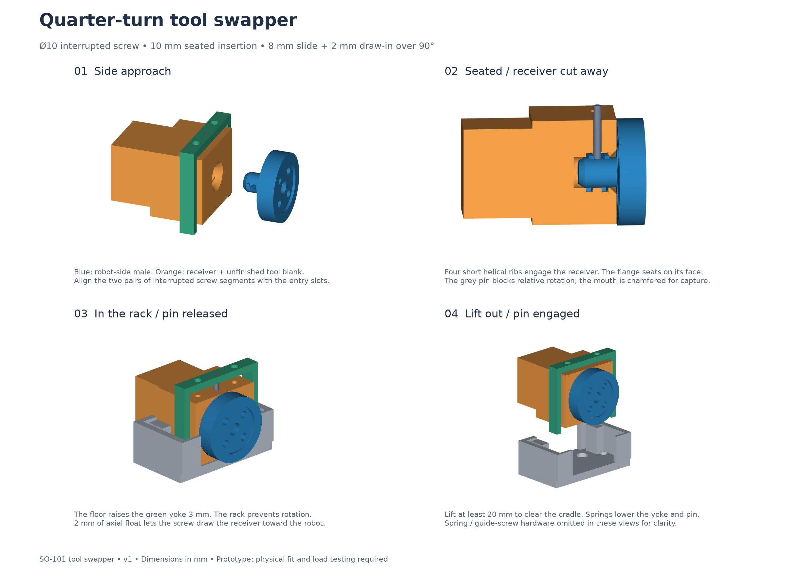
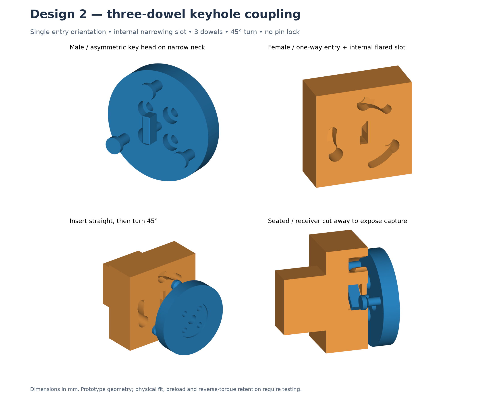

# robo_swap_101

SO-101 leader/follower teleoperation experiments and a prototype quarter-turn tool swapper for the follower wrist.

The project includes Python helpers for calibration and instrumented teleoperation, recorded diagnostic runs, and editable CAD with STEP/STL exports, drawings, and a browser preview.



## Project contents

| Path | Purpose |
| --- | --- |
| `arms.json` | Recorded leader/follower USB identities, macOS serial ports, and calibration IDs |
| `calibrate_arm.py` | Calibrate one arm after connecting the bus and disabling torque |
| `teleoperate_arms.py` | LeRobot launcher with bounded write retries and default relative motion limits |
| `diagnose_teleop.py` | Instrument teleoperation and save timing, observations, and actions |
| `diagnostics/`, `diagnostics_startup.txt` | Recorded diagnostic output from local experiments |
| `calibration_backups/` | Historical calibration backup; the included follower file is incomplete |
| `design/tool_swapper_v1/` | Original interrupted-screw coupling, pin lock, rack, CAD, and validation |
| `design/tool_swapper_v2/` | Single-orientation keyhole coupling with three flared dowels, CAD, and validation |

## Robot setup

The local robot environment used Python 3.12 and LeRobot 0.6.1. Create an isolated environment and install the robot dependencies:

```sh
uv venv --python 3.12 .venv
uv pip install --python .venv/bin/python -r requirements.txt
source .venv/bin/activate
```

Before running hardware, identify your own serial devices and calibration IDs. Update `arms.json` for reference and update the hard-coded ports and IDs in `calibrate_arm.py`. The scripts do **not** load `arms.json` automatically. The recorded USB identities and calibration files describe the original bench setup.

Calibrate each arm with its motion area clear and the arm supported as needed:

```sh
python calibrate_arm.py leader
python calibrate_arm.py follower
```

Example teleoperation using the recorded macOS ports (replace them and the IDs for your hardware):

```sh
python teleoperate_arms.py \
  --robot.type=so101_follower \
  --robot.port=/dev/cu.usbmodem5A7A0547771 \
  --robot.id=so101_follower_5A7A054777 \
  --teleop.type=so101_leader \
  --teleop.port=/dev/cu.usbmodem5A680086601 \
  --teleop.id=so101_leader_5A68008660
```

The launcher retries configuration writes at least three times and supplies `--robot.max_relative_target` defaults of 10 for shoulder pan/lift, elbow flex, and wrist roll, and 20 for wrist flex and gripper. An explicit `--robot.max_relative_target` argument overrides these defaults. These limits do not establish collision safety.

For an instrumented run, use `diagnose_teleop.py` with the same robot/teleop arguments plus `--teleop_time_s=5` and an explicit `--robot.max_relative_target` setting. The diagnostic script waits three seconds before recording; despite its name, the duration comes from the CLI argument. It overwrites `diagnostics/loop.txt`, `diagnostics/teleop_5s.json`, and `diagnostics/teleop_5s.log`.

## Tool swapper design

The [second design](design/tool_swapper_v2/README.md) uses an asymmetric vertical key, a single-orientation entry slot, and an internal flared cavity that narrows through a 45° turn. Three headed dowels follow ramps for 0.8 mm nominal draw-in. This version removes the pin lock and retains the original SO-101 wrist mounting pattern. Physical fit and clamp preload require testing.



Download the [v2 CAD, STL, and source package](design/tool_swapper_v2/SO101_tool_swapper_v2.zip), or use its individual files. The original design remains below.

Start with the [detailed design README](design/tool_swapper_v1/README.md) for dimensions, docking sequence, proposed hardware, manufacturing considerations, and rebuild commands. Open `design/tool_swapper_v1/preview.html` in a browser for the included preview, or import the STEP/STL files from `cad/` into your CAD tool or slicer. A packaged copy is included as `SO101_tool_swapper_v1.zip`.

The mechanism uses a quarter-turn interrupted screw, a spring-return locking pin/yoke, and an open-top rack. The receiver includes an unfinished tool blank; a pipette holder or actuator is not implemented.

**Prototype status:** CAD checks cover sampled geometry and interference only. The parts have no verified payload, strength, backlash, or cycle-life rating. Fit-check by hand before powered trials. Robot scripts can move hardware; keep the workspace clear and support the follower when torque is disabled. Removing the gripper motor may require changes to the robot motor configuration.

## Dependencies and licensing

Robot dependencies are listed in `requirements.txt`; CAD dependencies and commands are documented separately in the design README. Local virtual environments, caches, macOS metadata, and credential files are excluded from Git.

The upstream SO-101 reference CAD is attributed in the design README, with its Apache-2.0 license retained at [reference/LICENSE](design/tool_swapper_v1/reference/LICENSE) and provenance in `reference/upstream_commit.json`. No additional license is assigned to the original project files in this initial publication.
