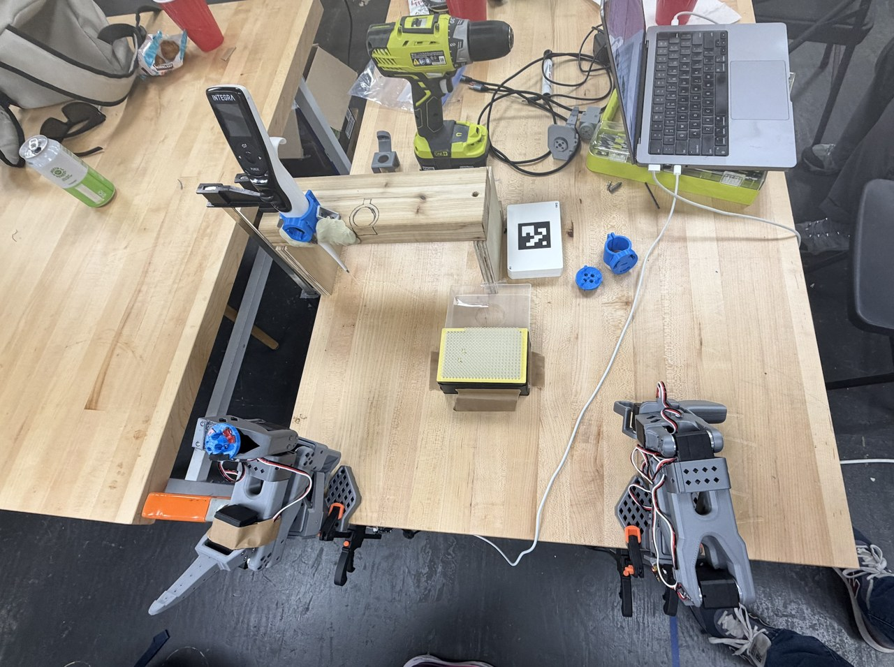
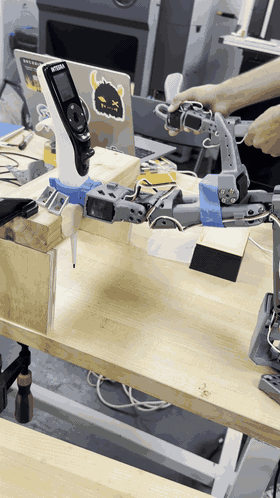
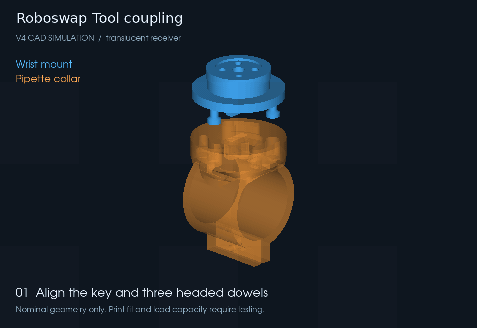
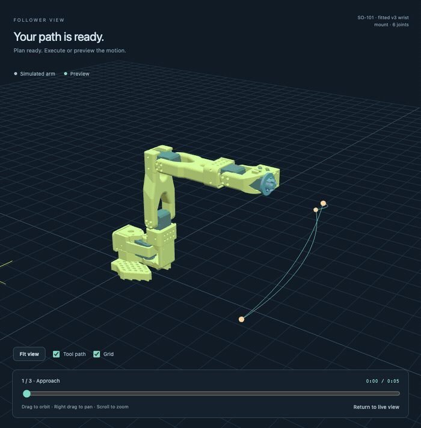

# Roboswap

**Swap the tool, not the robot.** A tool changer for benchtop liquid handling, built around the SO-101 robot arm.

🏆 **Hackathon winner** · Built by Philip, Neil, Apurva, Maya, and Leo

[Hardware demo](#teleoperated-hardware-demo) · [Design](#the-tool-changer) · [Animated simulations](#animated-simulations) · [Try it locally](#try-it-without-a-robot)

## The problem

Lab work involves more than pipetting. A single workflow can require moving labware, dispensing liquids, changing tips, and opening tubes. Dedicated liquid-handling stations organize these tasks around a fixed deck; a robot arm offers more freedom, but its usefulness still depends on the tool at its wrist.

Roboswap explores a different setup: **one benchtop arm that can pick up the tool each step needs**. Start with an electronic pipette, then extend the same idea to multichannel pipettes, grippers, and decappers. Those additional tools are the direction we want to take, rather than capabilities demonstrated by this prototype.



## Teleoperated hardware demo

We demonstrated pipette attachment with an SO-101 leader/follower pair: a person moves the leader arm, and the follower mirrors that motion at the bench.

<p align="center">
  <a href="docs/media/teleoperation-demo.mp4">
    
  </a>
</p>

<p align="center">
  <a href="docs/media/teleoperation-demo.mp4">Watch the full 45-second demo</a> · <a href="https://drive.google.com/file/d/1_4_yJLBgcuWlU159tA-3w_Z1VML-Q9Xl/view">Original recording on Drive</a>
</p>

The loop shows the pipette lifting out of its holder and moving over the bench, excerpted from our hackathon recording at its original speed. **This is teleoperation:** reliable autonomous tool pickup is still an open problem for the project.

## The tool changer

Our hackathon build paired an **SO-101 arm, an Integra electronic pipette, a 3D-printed attachment, and a simple wooden pipette holder**. We explored both gripping a collar with the stock jaws and replacing the wrist attachment with a dedicated coupling.

The CAD in this repository develops that coupling through several iterations. The latest [v4 design](design/tool_swapper_v4_flared_pipette/README.md) combines:

- **A keyed wrist mount:** an asymmetric central key sets the entry orientation, with three headed dowels around it.
- **An insert-and-turn connection:** a nominal 45° turn follows ramped tracks for 0.8 mm of axial draw-in. Reverse the turn to release.
- **A pipette collar:** a compact round receiver joins the fitted 31 mm collar; a 5 mm wrist spacer preserves access to the mounting screws.
- **Printable parts and inspectable geometry:** STL files, available STEP exports, source scripts, dimensions, and nominal fit checks live alongside the design.

This CAD iteration is separate from the hardware footage above. It has **no positive anti-rotation latch**, and physical fit, preload, payload, and cycle life remain unqualified.

## Animated simulations

<table>
  <tr>
    <th>Coupling: insert, turn, release</th>
    <th>Sequence Studio: preview a motion plan</th>
  </tr>
  <tr>
    <td width="50%"></td>
    <td width="50%"></td>
  </tr>
  <tr>
    <td>Rendered from the actual v4 meshes and assembly transforms. The receiver is translucent to reveal the engagement. This shows nominal geometry.</td>
    <td>Captured from the running simulator with an illustrative three-position sequence. The solid arm marks the starting pose; the translucent arm previews the planned motion.</td>
  </tr>
</table>

### Teach, plan, preview, play

[Sequence Studio](robot_viewer/README.md) is the browser interface for teaching movements and trying sequences before running them on the follower:

1. **Teach** named positions with the leader arm, or use joint sliders in simulation.
2. **Arrange** saved positions, reorder steps, and set dwell times.
3. **Plan and preview** smooth joint trajectories with a tool path and timeline. A relative pickup-tip action adds a modeled 3 mm down/up stroke.
4. **Execute** the stored plan in simulation, or explicitly connect a calibrated follower for hardware playback.

Sequences save locally and support JSON import/export. Simulation works without a connected arm. Preview and playback use the same stored plan, but the planner does not check collisions or guarantee physical positioning accuracy.

[View the full Studio interface](docs/media/sequence-studio.jpg)

## What worked, and what comes next

| Area | Hackathon result / current status |
| --- | --- |
| Pipette attachment | Demonstrated through leader/follower teleoperation. |
| Motion sequencing | Save positions, plan paths, and preview them in simulation. |
| Mechanical locking | Friction and print tolerances made attachment finicky. A more robust locking mechanism is a priority. |
| Automatic docking | The SO-101 setup was not precise enough for reliable automated attachment. Better positioning and feedback remain future work. |
| Vision | The presentation showed standalone ChArUco camera calibration, pose tracking, and tip detection. Camera feedback was not integrated into robot control. |

The next steps are a reliable tool lock, repeatable docking with a higher-precision arm or improved feedback, and integration of the vision work. The goal is to make tool changes dependable enough to build larger lab workflows around them.

## Try it without a robot

Use **Node.js 22.12+** to build the browser. The simulation backend uses only Python's standard library; Python 3.12 was used for development.

```sh
git clone https://github.com/RoboDrop/robo_swap_101.git
cd robo_swap_101

cd robot_viewer
npm ci
npm run build
cd ..

python3 -m so101_studio
```

Open **[http://127.0.0.1:8766](http://127.0.0.1:8766)**. Move the joint sliders, record a few positions, and select **Plan sequence → Preview**. The server starts in simulation with hardware disabled.

For the original model explorer with joint sliders and demo motion, open **[http://127.0.0.1:8766/model-viewer.html](http://127.0.0.1:8766/model-viewer.html)**.

### Connect your own hardware

Start with the [hardware setup guide](docs/hardware-setup.md) for LeRobot installation, calibration, command-line teleoperation, and VIAFLO pipettor control. Then follow the [Studio connection and playback guide](robot_viewer/README.md).

Configure your own USB identities and calibration IDs before connecting. `arms.json` describes our bench setup; the standalone CLI scripts have separate settings. Hardware access requires `--enable-hardware` and explicit connection in the browser. Keep the motion area clear and physical power control accessible; software Stop is a hold command, not a physical emergency stop.

## Explore the repository

| Component | Where to start |
| --- | --- |
| Browser interface and 3D simulation | [Sequence Studio](robot_viewer/README.md) |
| Local API, storage, planner, and hardware adapters | [Backend guide](so101_studio/README.md) |
| Calibration and teleoperation | [Hardware setup](docs/hardware-setup.md), [teleoperate_arms.py](teleoperate_arms.py) |
| Electronic pipette control | [VIAFLO controller](tools/viaflo/README.md) |
| Latest printable coupling and pipette collar | [v4 flared pipette design](design/tool_swapper_v4_flared_pipette/README.md) |
| Earlier CAD iterations | [v1 interrupted screw](design/tool_swapper_v1/README.md), [v2 keyed coupling](design/tool_swapper_v2/README.md), [v3 fitted pair](design/tool_swapper_v3/README.md), [thin-wall variant](design/tool_swapper_v3_thin_wall/README.md) |
| Hardware-free regression tests | [tests/](tests/) |
| Demo assets and provenance | [Media notes](docs/media/README.md) |

Use the matching parts specified in each design's README. Variants are prototypes with different fits and clearances, not interchangeable releases.

## Development

After installing the robot dependencies described in the [setup guide](docs/hardware-setup.md) and the browser dependencies above:

```sh
.venv/bin/python -m unittest discover -s tests -v
cd robot_viewer
npm run build
```

Tests use simulated devices and fake transports. CAD checks are separate; rebuild instructions and dependencies are in each design directory. Local sequence libraries, virtual environments, generated browser bundles, credentials, and packet logs are ignored by Git. Export important sequences from Studio or back up `data/sequences.json`.

## Team and acknowledgments

Built by **Philip, Neil, Apurva, Maya, and Leo**. Thanks to **Mark** for help with 3D printing.

Roboswap builds on the SO-101 platform and LeRobot. Upstream model provenance and Apache-2.0 licensing are retained with the [robot models](robot_viewer/public/robots/so101/README.md) and [reference CAD](design/tool_swapper_v1/reference/LICENSE). No additional license has been assigned to the original project files.
